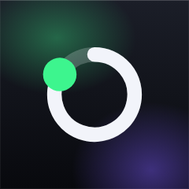
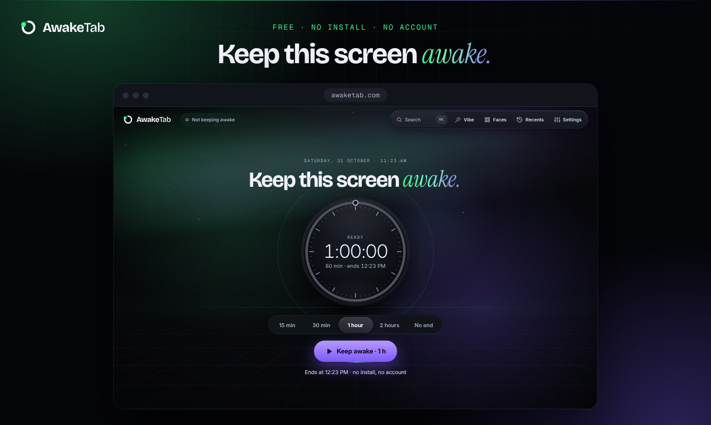
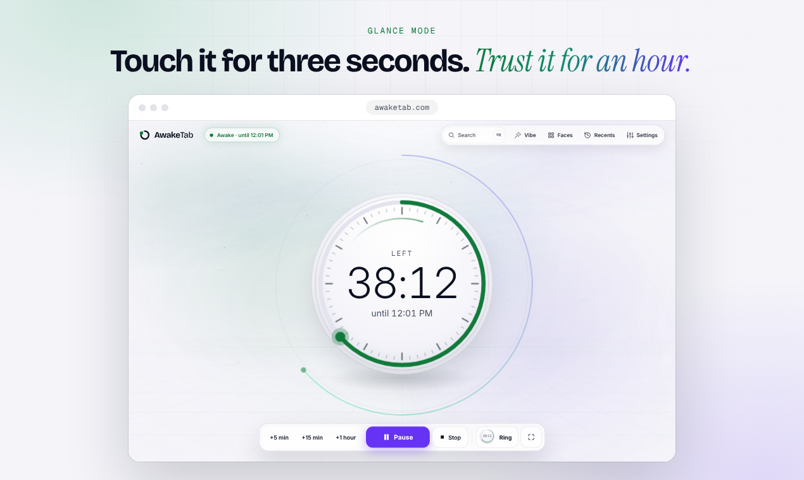
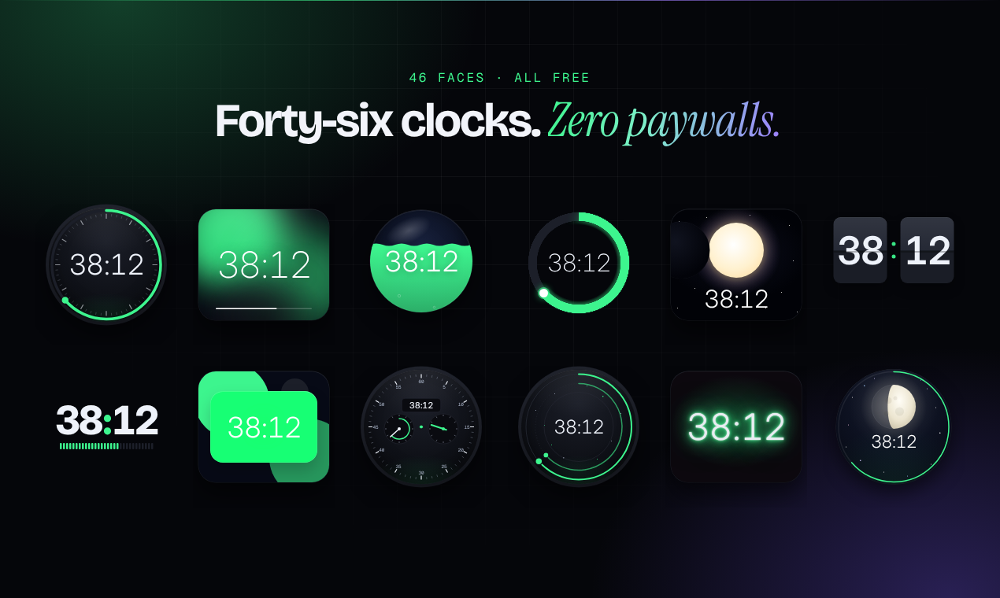
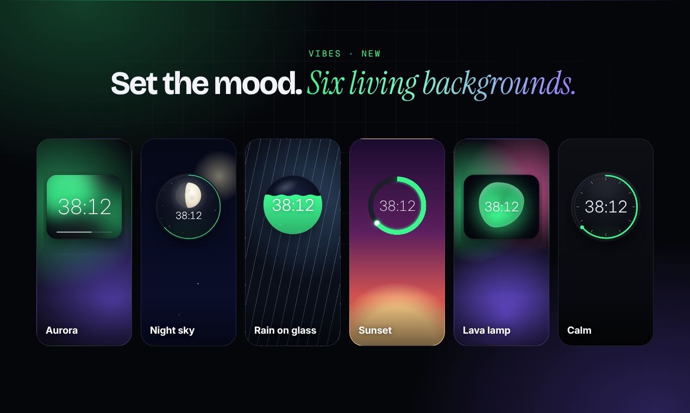

<p align="center">
  <a href="https://awaketab.com/">
    
  </a>
</p>

<h1 align="center">AwakeTab</h1>

<p align="center">
  <b>Keep this screen awake.</b><br>
  One click, a big calm clock with the time left, and an honest status if your device says no.<br>
  Free. No install. No account.
</p>

<p align="center">
  <a href="https://awaketab.com/"><b>Open AwakeTab</b></a> ·
  <a href="#documentation">Documentation</a> ·
  <a href="https://github.com/soubhik-biswas/awaketab/discussions">Ask a question</a> ·
  <a href="https://github.com/soubhik-biswas/awaketab/issues/new/choose">Report an issue</a>
</p>

<p align="center">
  <a href="https://github.com/soubhik-biswas/awaketab/actions/workflows/ci.yml"></a>
  <a href="https://scorecard.dev/viewer/?uri=github.com/soubhik-biswas/awaketab"></a>
  <a href="LICENSE"></a>
  <a href=".nvmrc"></a>
</p>

[](https://awaketab.com/)

**Explore:** [How it works](#how-it-works) · [What you get](#what-you-get) · [Ways to use it](#ways-to-use-it) · [Quick start](#quick-start) · [Development](#development-commands) · [Deployment](#environments-and-deployment) · [Codebase](#architecture-and-repository-map) · [Help](#troubleshooting)

## How it works

A recipe should stay visible while your hands are busy. A slide timer or a wall dashboard should not need a tap every few minutes. AwakeTab asks the browser for a **screen wake lock**, the permission to keep a display on, and then tells you the truth about the answer.

1. **Pick a length:** 15 min, 30 min, 1 hour, 2 hours or No end.
2. **Press Keep awake.** The clock counts down and shows the time the session ends.
3. **Glance at it from across the room.** The controls step back and the clock stays readable.

[](https://awaketab.com/)

The status pill only ever reports what the browser confirmed. A running countdown alone is not proof that a lock was granted.

| The pill says | What it means |
| --- | --- |
| **Not keeping awake** | No session is running. |
| **Asking the browser…** | Waiting for the browser's answer. |
| **Awake · until 12:26 PM** | The browser confirmed the lock. With No end it reads "until you stop". |
| **Paused · 57 min left** | You paused the session; the screen may sleep. |
| **Tap to resume · tab was hidden** | The browser released the lock while the tab was hidden. One tap takes it back. |
| **Not awake · battery saver** | The browser refused. The reason and the fix are one tap away. |
| **No wake lock in this browser** | This browser has no wake lock. A video fallback is offered instead. |
| **Awake via video · until 12:26 PM** | The fallback video is keeping the screen on. |

**Keep the tab visible.** Switching tabs, minimising the window or locking the device ends a wake lock; that is how browsers work. AwakeTab cannot override a deliberate device lock, a closed laptop lid or every power policy. It never fakes mouse movement and never changes your status in chat apps. See the [browser support matrix](https://awaketab.com/learn/browser-support-matrix) and the [device guides](https://awaketab.com/on).

## What you get

Everything is free, with no account, no ads on the awake screen and no tracking.

[](https://awaketab.com/)

| Area | Included |
| --- | --- |
| Sessions | Five lengths from 15 minutes to No end; add 5 minutes, 15 minutes or 1 hour while running; Pause, Stop and Start again; sessions survive a reload |
| Clock faces | 46 faces: analog, digital and ambient. Press **F** to browse them |
| Backgrounds | Six living backgrounds: Aurora, Night sky, Rain on glass, Sunset, Lava lamp and Calm. Motion can be set to still |
| Look | Light, dark and OLED themes that follow the system setting; 12- or 24-hour time |
| Your setups | Presets for the things you do every day, recent sessions and history, kept on this device |
| Sound | An optional end-of-session chime |
| Keyboard | **Space** start or pause · **Enter** start · **←** **→** length · **+** **−** five minutes · **F** faces · **⇧F** fullscreen · **V** backgrounds · **R** recents · **,** settings · **⌘K** search and commands |
| Access | Screen-reader labels throughout, visible focus, 44 px targets, reduced-motion support |
| Languages | English, Spanish, Portuguese (Brazil), German, French, Japanese, Chinese and Hindi |
| Offline | Installs as an app and keeps working without a connection |

[](https://awaketab.com/)

Settings, presets and history stay in your browser; there is no sync at launch. A paid plan for syncing one setup across several screens is built but switched off, and keeping a screen awake stays free. See [requirements](docs/02-prd.md) for the wider specification and [data storage](docs/08-data-storage.md) for what is saved where.

## Ways to use it

| Option | Best for | Availability and limits |
| --- | --- | --- |
| **[Web tool](https://awaketab.com/)** | A recipe, a reading session or a second screen | Live and free. Keep the tab visible. A supporting browser can install it as an app. |
| **[Chrome and Edge extension](https://awaketab.com/extension)** | Keeping the screen on while you work in other tabs and apps | Buildable from this repository; the store listing is not published yet. One click from the toolbar: 15 min, 30 min, 1 hour or no end, with the time left on the icon. A closed lid still sleeps. |
| **Mini clock** | Seeing the time left while another window is in front | A small always-on-top clock, in browsers that support Picture-in-Picture windows. |
| **[Website widget](https://awaketab.com/embed)** | Keep-awake controls inside your own page, such as a recipe | A script tag adds the widget. The free widget shows a small credit. |
| **[Wall mode](https://awaketab.com/kiosk)** | Wall clocks and shared displays nobody touches | A link builder for a full-screen clock. Normal browser and operating-system limits apply. |
| **[`@awaketab/wake`](packages/wake/README.md)** | Adding a wake lock to your own app | The library source and builds are here, with React, Preact and Vue adapters. It is not on npm yet. |

<details>
<summary><b>Build and load the extension</b></summary>

Complete [Quick start](#quick-start), then run from the repository root:

```bash
pnpm -F extension build
```

Open `chrome://extensions` or `edge://extensions`, enable **Developer mode**, choose **Load unpacked**, and select `apps/extension/.output/chrome-mv3`. See [the extension specification](docs/10-extension-spec.md) for behaviour and permissions. Firefox and Safari have no power API for extensions.

For a validated release ZIP, see the [extension release guide](apps/extension/store/PUBLISHING.md).

</details>

<details>
<summary><b>Add the widget or build the library</b></summary>

The [widget builder](https://awaketab.com/embed) produces a tag such as:

```html
<script async src="https://awaketab.com/embed.js" data-mode="cook" data-theme="auto" data-size="compact"></script>
```

Serve the host page over HTTPS. The loader creates an iframe with `allow="screen-wake-lock"`; a restrictive Permissions Policy on the host page can still block it. See [the embed reference](docs/11-embed-spec.md).

To create a library archive, start at the root after setup:

```bash
pnpm -F @awaketab/wake build
cd packages/wake
pnpm pack
```

Install the resulting `.tgz` in your project. Inside this monorepo use `"@awaketab/wake": "workspace:*"` instead. The [library README](packages/wake/README.md) explains its API, adapters and cleanup.

</details>

## Quick start

Install **Git** and **Node.js 22**. Setup checks the Node version, prepares **pnpm 12.17.0** through Corepack when needed, installs dependencies and copies the site's example settings to `apps/site/.dev.vars` without overwriting an existing file.

```bash
git clone https://github.com/soubhik-biswas/awaketab.git
cd awaketab
node scripts/setup.mjs
pnpm dev
```

Open **[http://localhost:3000](http://localhost:3000)**. Choose a length and press **Keep awake**. Keep the terminal open while developing; **Ctrl+C** stops the server.

**The local timer needs no account, payment credentials or Cloudflare login.** `pnpm dev` serves the Next.js website and its route handlers. Licence activation, checkout and other server integrations need their own service setup or test harness; see [`apps/site/.env.example`](apps/site/.env.example).

With a Node version manager, `fnm use` or `nvm use` in the repository selects the version in [`.nvmrc`](.nvmrc). See [Contributing](CONTRIBUTING.md#set-up) for setup options and platform guidance.

## Development commands

Run these from the **repository root**, unless a command changes directory. A workspace is a package inside this repository; `-F site` or `-F extension` selects one.

| Command | Purpose |
| --- | --- |
| `pnpm run setup` | Repeat setup safely; use `node scripts/setup.mjs` before pnpm exists. |
| `pnpm dev` | Start the Next.js website with automatic reload at port 3000. |
| `pnpm -F extension dev` | Develop the extension with WXT. |
| `pnpm build` | Build shared packages, website and extension. |
| `pnpm -F site start` | Serve the built Next.js website locally. |
| `pnpm format` | Format repository files. |
| `pnpm lint` | Check formatting, unused code, source rules and styles. |
| `pnpm typecheck` | Check TypeScript in every workspace. |
| `pnpm test` | Run shared-package, extension and Next.js site tests. |
| `pnpm test:e2e:ext` | Run extension browser journeys. |
| `pnpm size` | Check the size budgets of the shared packages after building. |
| `pnpm lighthouse` | Run configured Lighthouse audits. |

Use **`pnpm run setup`**, not `pnpm setup`: the latter is pnpm's own command. [`package.json`](package.json) and [`apps/site/package.json`](apps/site/package.json) are the script reference.

## Environments and deployment

Cloudflare Workers runs the Next.js site; Cloudflare manages DNS. Cloudflare's own GitHub connection builds and deploys `main`, so no deploy token is stored in GitHub. See [Deployment](docs/DEPLOYMENT.md) for the exact settings, commands and rollback steps.

| Environment | URL / source | Payments and service data |
| --- | --- | --- |
| Local | `http://localhost:3000`, working tree | Sandbox defaults; no credentials needed for the timer |
| **Preview** | **[play.awaketab.com](https://play.awaketab.com/)**, any branch the maintainer deploys by hand | Sandbox payments; separate database, storage and event dataset; kept out of search |
| **Production** | **[awaketab.com](https://awaketab.com/)**, every push to `main` | The free tool; purchases switched off; its own database, storage and credentials |

1. Send a focused pull request into `main`; CI runs the checks on it.
2. When a change needs a live check, the maintainer deploys its branch to the preview with `pnpm -F site run deploy:preview`.
3. Merge into `main` after review and passing checks.
4. Cloudflare runs the same checks again, applies database migrations and deploys. A failing check stops the deploy.

The preview sends `X-Robots-Tag: noindex`, which keeps it out of search engines but does not restrict access.

## Architecture and repository map

AwakeTab is a **monorepo**: applications and shared packages developed together. The Next.js application lives in `apps/site`. Clock faces load when they are first used.

- **`@awaketab/wake`** requests a lock, handles release events and exposes seven lock states.
- **`@awaketab/core`** manages sessions, durations, local storage, statistics, capabilities and licence verification.
- **The web tool and extension** reuse these packages. The extension supplies a browser power-API adapter.
- **Next.js route handlers** serve licence, widget-config and event endpoints on Workers, with D1, Cloudflare KV and Analytics Engine bindings. The basic timer runs in the browser.

```text
awaketab/
├── apps/
│   ├── site/
│   │   ├── app/             Next.js routes, tool pages and API route handlers
│   │   ├── content/         Guides and articles in eight languages
│   │   ├── components/      Tool UI, clock faces, site shell and shadcn/ui primitives
│   │   ├── lib/             Server code, embed widget, SEO and shared helpers
│   │   ├── public/          Fonts, icons and static assets
│   │   └── wrangler.jsonc   Worker bindings for production and preview
│   └── extension/           WXT extension, popup and background worker
├── packages/
│   ├── wake/               Lock engine, fallback and adapters
│   └── core/               Sessions, storage and shared logic
├── docs/                   Product and engineering references
├── scripts/                Setup, licence keys, KV backups and lint helpers
└── .github/                Workflows, issue forms and labels
```

The stack centres on Next.js, TypeScript, Tailwind CSS, Cloudflare Workers and WXT. [Architecture](docs/03-architecture.md) describes the design; [Next.js deployment](docs/DEPLOYMENT.md) covers hosting, and [the engine specification](docs/04-engine-spec.md) describes state transitions.

## Configuration

**Basic local tool:** run setup; no real secrets are required. Every setting is listed with its purpose in [`apps/site/.env.example`](apps/site/.env.example). The ones that change what a build offers:

| Setting | Effect |
| --- | --- |
| `PUBLIC_SITE_URL=https://awaketab.com` | Sign-in and checkout return links |
| `PUBLIC_POLAR_SERVER=sandbox` | Sandbox checkout and development-key trust; production uses `production` |
| `NEXT_PUBLIC_DEPLOY_ENV=play` | Marks the preview build: robots.txt, page metadata and a header keep it out of search |
| `NEXT_PUBLIC_PRO_ENABLED=0` | Keeps the paid plan (sync, sign-in, checkout) switched off |
| `NEXT_PUBLIC_ADS_ENABLED=0` | Disables the content-page ad slots |

`NEXT_PUBLIC_*` switches are read when the site is built, so set them in the build environment. Server settings and secrets reach the Worker at runtime; locally they come from `apps/site/.dev.vars`.

<details>
<summary><b>Server integrations and credentials</b></summary>

Licence activation, webhooks and remote widget configuration need runtime bindings and secrets. Start from [`apps/site/.env.example`](apps/site/.env.example), keeping real secrets in an ignored local file or Cloudflare settings. Never put private keys or access tokens in `PUBLIC_*` or `NEXT_PUBLIC_*` variables.

Keep Production and Preview credentials, signing keys, licence storage and analytics separate. The development key in [`scripts/dev-license-key.json`](scripts/dev-license-key.json) is deliberately public; production must not trust it. Build checks enforce that boundary.

References: [configuration and secrets](docs/03-architecture.md#7-environments-configuration-and-secrets), [payments and licences](docs/09-monetization-impl.md), and [hosting setup](docs/DEPLOYMENT.md).

</details>

## Testing and quality

`pnpm test` covers shared packages, the scripts, the extension and the Next.js site.

| Check | What it verifies |
| --- | --- |
| Unit and UI | Lock transitions, timers, storage, feature gates, parsers and UI behaviour with controlled inputs |
| Route handlers | Site API handlers with in-memory storage, event and payment-service fakes; no production calls |
| Extension journeys | The built extension in Chromium, with axe accessibility checks |
| Size and Lighthouse | Bundle budgets and selected performance/accessibility audits |
| Manual devices | Physical power and display behaviour that simulated locks cannot establish |

Install Chromium once and run the checks from the root:

```bash
node scripts/setup.mjs --with-browsers
pnpm lint
pnpm typecheck
pnpm test
pnpm build
pnpm size
pnpm test:e2e:ext
```

The website has no browser end-to-end suite yet, so check visible changes by hand. A fake wake lock can test transitions, but cannot prove a phone stayed lit.

CI checks `main` and pull requests. Extension Chromium journeys run on pull requests, and dependency auditing runs nightly. See [the testing strategy](docs/13-testing-strategy.md), [workflows](.github/workflows) and [how we tested](https://awaketab.com/learn/how-we-tested).

## Troubleshooting

| Symptom | Likely cause and next step |
| --- | --- |
| Setup reports the wrong Node version | Select Node.js 22, then rerun setup. Other major versions are outside the declared range. |
| `pnpm setup` does something unexpected | Run `pnpm run setup` for the project's script. |
| Corepack is missing or cannot prepare pnpm | Follow setup's error message. Installing `pnpm@12.17.0` globally is an alternative. |
| The status changes when I switch tabs | Browsers release a wake lock when the tab is hidden. Return to the tab and tap once; use the extension to keep the screen on while you work elsewhere. |
| The pill says Not awake or No wake lock | Open **See the fix** beside the status. Check browser support, site settings and iframe permission. Use HTTPS or localhost. |
| The device still sleeps or locks | Check device settings and the status explanation. Wake lock cannot override a deliberate lock, lid closure or every power policy. |
| The local timer works but `/api/*` does not | The route handlers need their secrets in `apps/site/.dev.vars` and the local bindings from `apps/site/wrangler.jsonc`. Fill in the values for the service you are testing, or use the route-handler tests. |
| Extension tests cannot find Chromium | Run `node scripts/setup.mjs --with-browsers`, build, then retry. |
| A production build fails the key check | A production build must not trust the public development key. Check `PUBLIC_POLAR_SERVER` and the keys in `packages/core/src/license.ts`. |

More help: [help centre](https://awaketab.com/help), [browser support](https://awaketab.com/learn/browser-support-matrix), [device guides](https://awaketab.com/on), [existing issues](https://github.com/soubhik-biswas/awaketab/issues).

## Contributing

A small documentation correction, accessibility improvement or reproducible bug is a useful first contribution. Read [Contributing](CONTRIBUTING.md) and the [Code of Conduct](CODE_OF_CONDUCT.md), then open a pull request against `main`.

- **Bug:** use the [issue forms](https://github.com/soubhik-biswas/awaketab/issues/new/choose). Include the URL, browser, OS, exact status text, reproduction steps and expected result. Leave out private data and licence keys.
- **Feature:** describe the problem and who it helps before starting a large change.
- **Pull request:** keep one topic, explain the change, list checks run, and include real screenshots for visible changes. Use plain-English commits without attribution trailers.

The contribution guide covers branches, formatting and review rules.

## Community

AwakeTab is maintained by one person, a few hours a week. Everyone is welcome to ask, report and contribute.

- **[Getting help](SUPPORT.md):** questions go to [Discussions](https://github.com/soubhik-biswas/awaketab/discussions), bugs to the [issue forms](https://github.com/soubhik-biswas/awaketab/issues/new/choose).
- **[Contributing](CONTRIBUTING.md):** setup, house rules and how pull requests are reviewed. Look for [good first issues](https://github.com/soubhik-biswas/awaketab/labels/good%20first%20issue).
- **[Roadmap](ROADMAP.md):** what AwakeTab is, what it deliberately is not, and what comes next.
- **[Governance](GOVERNANCE.md):** who decides, how decisions are recorded, and response times.
- **[Code of Conduct](CODE_OF_CONDUCT.md):** how we treat each other, and how to report a problem privately.
- **[Security policy](SECURITY.md):** report vulnerabilities privately, never in a public issue.

## Project status and roadmap

| Status | Scope |
| --- | --- |
| **Live** | The free web tool with 46 faces and six backgrounds, the content site in eight languages, the website widget, wall mode and the preview environment |
| **Built, not yet published** | The Chrome and Edge extension (store listing pending) and the `@awaketab/wake` library (npm release pending) |
| **Built, switched off** | The paid plan for syncing several screens, with sign-in and checkout |

This is a snapshot, not a delivery promise. The [roadmap](ROADMAP.md) says what comes next, and the [product changelog](https://awaketab.com/changelog) records what shipped.

## Documentation

| Start here | What you will find |
| --- | --- |
| [User guides](https://awaketab.com/learn) · [Help centre](https://awaketab.com/help) | Usage, browser limits and wake-lock behaviour |
| [Contributing](CONTRIBUTING.md) | Setup, house rules, tests and pull requests |
| [Conventions](docs/00-conventions.md) | Canonical names, routes, storage keys and budgets |
| [Architecture](docs/03-architecture.md) · [Engine](docs/04-engine-spec.md) | Components, data flow and state transitions |
| [Frontend](docs/05-frontend-spec.md) · [Design](DESIGN.md) | UI contracts, accessibility and design system |
| [Data and storage](docs/08-data-storage.md) | Local and server persistence |
| [Extension](docs/10-extension-spec.md) · [Embed](docs/11-embed-spec.md) · [Library](packages/wake/README.md) | Integration references |
| [Deployment](docs/DEPLOYMENT.md) | Worker environments, domains, commands, rollback and preview isolation |
| [Testing](docs/13-testing-strategy.md) · [DevOps](docs/14-devops.md) | Test strategy, operations, backups and recovery |

## Support, security and licence

Ask questions in [Discussions](https://github.com/soubhik-biswas/awaketab/discussions) and report bugs with the [issue forms](https://github.com/soubhik-biswas/awaketab/issues/new/choose); [SUPPORT.md](SUPPORT.md) says what goes where. Report vulnerabilities through GitHub's [private vulnerability reporting](https://github.com/soubhik-biswas/awaketab/security/advisories/new), as described in [SECURITY.md](SECURITY.md). Do not post security reports in public issues.

Released under the **[MIT License](LICENSE)**. © 2026 Soubhik Biswas. The hosted product has its own [privacy information](https://awaketab.com/privacy) and [terms](https://awaketab.com/terms).
