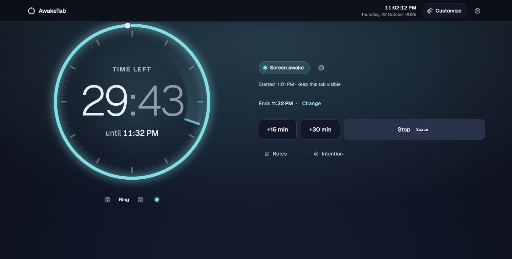
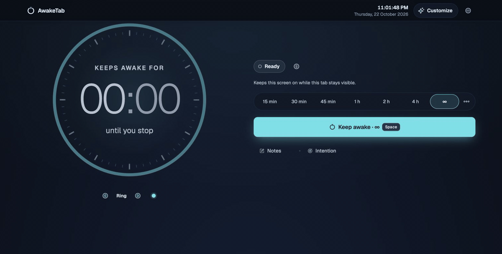
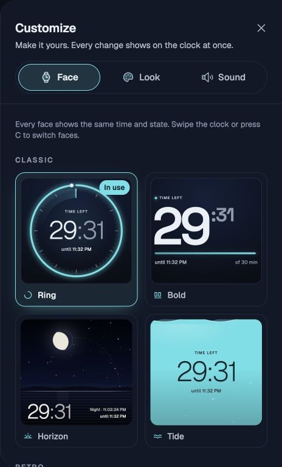

<p align="center">
  <a href="https://awaketab.com/">
    <picture>
      <source media="(prefers-color-scheme: dark)" srcset=".github/readme/hero-dark.svg">
      
    </picture>
  </a>
</p>

<h1 align="center">Keep the screen on. Know when it is.</h1>

<p align="center">
  A free browser tool for recipes, reading, presentations and focused work.<br>
  Pick a duration, start a session, and look for <b>Screen awake</b>.<br>
  No account needed. No ads on the awake screen.
</p>

<p align="center">
  <a href="https://awaketab.com/"><b>Try AwakeTab</b></a> ·
  <a href="https://play.awaketab.com/">Testing environment</a> ·
  <a href="#documentation">Documentation</a> ·
  <a href="https://github.com/soubhik-biswas/awaketab/issues/new/choose">Report an issue</a>
</p>

<p align="center">
  <a href="https://github.com/soubhik-biswas/awaketab/actions/workflows/ci.yml"></a>
  <a href="LICENSE"></a>
  <a href=".nvmrc"></a>
</p>

[](https://awaketab.com/)

*The real web tool on production. Its status follows the browser's confirmed wake lock.*

**Explore:** [Demo](#see-it-in-action) · [Features](#features) · [Ways to use it](#choose-how-to-use-it) · [Quick start](#quick-start) · [Development](#development-commands) · [Deployment](#environments-and-deployment) · [Codebase](#architecture-and-repository-map) · [Help](#troubleshooting)

The Next.js website lives in `apps/site`. See [Next.js deployment](docs/DEPLOYMENT.md) for the production and preview Worker pipelines.

## See it in action

[](.github/readme/awaketab-product-demo.mp4)

**Choose 30 min → Keep awake → confirm Screen awake → Stop.** The animation uses real browser captures, with shortened pauses between steps. [Watch the narrated 18-second product demo](.github/readme/awaketab-product-demo.mp4) with on-screen captions, or read the [WebVTT transcript](.github/readme/awaketab-product-demo.en.vtt). Open the [full-size animation](.github/readme/session-demo.gif) for a closer look.

The tool may request a session as soon as it opens. If it is already running, press **Stop** before choosing another duration. A browser that requires a tap will ask for one.

<details>
<summary><b>Make the clock yours</b></summary>

Open **Customize → Face**, use the arrows below the clock, or press **C**. All twelve clock faces are free. Look and Sound live in the same drawer.

<p align="center">
  
</p>

The capture shows part of the face gallery. Try the other faces and focus tools in [the product](https://awaketab.com/).

</details>

## Why AwakeTab

A recipe should stay visible while your hands are busy. A reading session should not need a tap every minute. A presentation clock or wall dashboard should show clearly whether the screen is still being kept awake.

AwakeTab asks for a **screen wake lock**, the browser's permission to keep a display on. The status reports the result, including when the browser releases or refuses it. A running countdown alone is not proof that a lock was granted.

| Status | Meaning |
| --- | --- |
| **Ready** | No lock is held. |
| **Starting…** | Waiting for the browser's answer. |
| **Screen awake** | The browser confirmed a native lock. |
| **Paused — tab hidden** | The lock was released; the tool asks again when the tab becomes visible. |
| **Blocked — here's the fix** | The browser refused. Open the explanation beside the status. |
| **Tap to use the fallback** | Native wake lock is unavailable; a tap can try the video fallback. |
| **Awake via video fallback** | The fallback video is playing. |

**Keep the web tab visible.** Switching tabs, minimising the window or locking the device can end the lock. AwakeTab cannot override a deliberate device lock, a closed laptop lid or every operating-system power restriction. It does not simulate mouse activity or change your availability in chat apps. See the [browser support matrix](https://awaketab.com/support-matrix) and [device guides](https://awaketab.com/on).

## Features

**The free tool is live. Production purchases are disabled.** Pro and business extras exist in the code, but are not currently available to buy. Testing checkout uses a sandbox and does not make a production purchase.

| Area | Available free | Licence-based extras implemented in the code |
| --- | --- | --- |
| Sessions | Presets from 15 min to 4 h, until a time, custom length up to 7 days, or until you stop; extend a session | Keeping the screen awake stays free. |
| Clock and appearance | All twelve clock faces; light, dark and OLED modes; Clear Night, Paper and Nord; free lamps and backgrounds | More palettes, lamps, backgrounds and presets; custom lamp colour |
| Focus and sound | Focus sounds, end sounds, Pomodoro timer, intention, breathing guide and second time zone | Sound mixer and repeating Pomodoro |
| Notes and history | One local note with formatting and export; Today and This week statistics | Multiple notes, longer history and statistics CSV export |
| Ambient display | Clock, Cook, Focus, Night and Minimal views | Personal message and business kiosk branding |
| Browser integration | Shortcuts, installable web app, cached offline tool, Picture-in-Picture where supported | Extension schedules and auto-start |

Some extras offer a five-minute preview; a preview does not create a licence. Preferences and notes stay in this browser, with no account-based sync. Export notes before clearing site data. Voice typing, where supported, uses the browser's speech service and may send audio to that service.

See [Free and Pro](https://awaketab.com/pro) for the current comparison, [requirements](docs/02-prd.md) for the wider specification, and [data storage](docs/08-data-storage.md) for persistence details.

## Choose how to use it

| Option | Best for | Availability and limits |
| --- | --- | --- |
| **[Web tool](https://awaketab.com/)** | A recipe, reading session or second screen | Live and free. Keep the tab visible. A supporting browser can install it for a standalone window and cached offline use. |
| **[Chrome / Edge extension](https://awaketab.com/extension)** | Working in another tab or window | Buildable here; store listing is not yet enabled. Uses the browser power API with Screen and System levels. A closed lid still sleeps. |
| **[Website widget](https://awaketab.com/embed)** | Keep-awake controls inside another website | Script loader and Cook widget implemented. Free widget includes attribution; licensed branding exists, with purchases closed. |
| **[Kiosk URL builder](https://awaketab.com/kiosk)** | Wall clocks and shared displays | Free parameters configure a display link. Persistent messages and custom logos need the relevant licence. Normal browser and OS limits apply. |
| **[`@awaketab/wake`](packages/wake/README.md)** | Adding wake lock to your application | Workspace source and builds available; not currently published to npm. Includes React, Preact and Vue adapters. |

<details>
<summary><b>Build and load the extension</b></summary>

Complete [Quick start](#quick-start), then run from the repository root:

```bash
pnpm -F extension build
```

Open `chrome://extensions` or `edge://extensions`, enable **Developer mode**, choose **Load unpacked**, and select `apps/extension/.output/chrome-mv3`. See [the extension specification](docs/10-extension-spec.md) for behaviour and permissions. There is no Firefox or Safari power-API extension here.

For a validated release ZIP, run `pnpm -F extension publish:package` to choose a version bump. The first unpublished version can use `pnpm -F extension publish:package --current`. The command runs checks and writes a versioned ZIP to your Desktop; purchases stay disabled and store submission is separate. See the [extension release guide](apps/extension/store/PUBLISHING.md).

</details>

<details>
<summary><b>Add the widget or build the library</b></summary>

The [widget builder](https://awaketab.com/embed) produces a tag such as:

```html
<script async src="https://awaketab.com/embed.js" data-mode="cook" data-theme="auto" data-size="compact"></script>
```

Serve the host page over HTTPS. The loader creates an iframe with `allow="screen-wake-lock"`; a restrictive host Permissions Policy can still block it. See [the embed reference](docs/11-embed-spec.md).

To create a library archive, start at the root after setup:

```bash
pnpm -F @awaketab/wake build
cd packages/wake
pnpm pack
```

Install the resulting `.tgz` in your project. Inside this monorepo use `"@awaketab/wake": "workspace:*"` instead. The [library README](packages/wake/README.md) explains its API, adapters and cleanup lifecycle.

</details>

## Quick start

Install **Git** and **Node.js 22**. Setup checks the Node version, prepares **pnpm 12.17.0** through Corepack when needed, installs dependencies and copies the site's example settings to `apps/site/.dev.vars` without overwriting an existing file.

```bash
git clone https://github.com/soubhik-biswas/awaketab.git
cd awaketab
node scripts/setup.mjs
pnpm dev
```

Open **[http://localhost:3000](http://localhost:3000)**. Choose a duration and start. Keep the terminal open while developing; **Ctrl+C** stops the server.

**The local timer needs no account, payment credentials or Cloudflare login.** `pnpm dev` serves the Next.js website and its route handlers. Licence activation, checkout and other server integrations need their own service setup or test harness; see [`apps/site/.env.example`](apps/site/.env.example).

With nvm, run `nvm install` and `nvm use` in the repository to select [`.nvmrc`](.nvmrc). See [Contributing](CONTRIBUTING.md#set-up) for setup options and platform guidance.

## Development commands

Run these from the **repository root**, unless a command changes directory. A workspace is a package inside this repository; `-F site` or `-F extension` selects one.

| Command | Purpose |
| --- | --- |
| `pnpm run setup` | Repeat setup safely; use `node scripts/setup.mjs` before pnpm exists. |
| `pnpm dev` | Start the Next.js website with automatic reload at port 3000. |
| `pnpm -F extension dev` | Develop the extension with WXT. |
| `pnpm build` | Build shared packages, website and extension. |
| `pnpm -F site start` | Serve the built Next.js website locally. |
| `pnpm format` | Format repository files. |
| `pnpm lint` | Check formatting, unused code, source rules and styles. |
| `pnpm typecheck` | Check TypeScript in every workspace. |
| `pnpm test` | Run shared-package, extension and Next.js site tests. |
| `pnpm test:e2e:ext` | Run extension browser journeys. |
| `pnpm size` | Check package and website bundle budgets after building. |
| `pnpm lighthouse` | Run configured Lighthouse audits. |

Use **`pnpm run setup`**, not `pnpm setup`: the latter is pnpm's own command. [`package.json`](package.json) and [`apps/site/package.json`](apps/site/package.json) are the script reference.

## Environments and deployment

Cloudflare Workers runs the Next.js site; Cloudflare manages DNS. `main` deploys to `awaketab-site`, and the owner can deploy any branch to the separate `awaketab-site-preview` Worker with a manually run workflow. See [Next.js deployment](docs/DEPLOYMENT.md) for the exact build commands and rollout checks.

| Environment | URL / source | Payments and service data |
| --- | --- | --- |
| Local | `http://localhost:3000`, working tree | Sandbox defaults; no live credentials needed for the timer |
| **Testing** | **[play.awaketab.com](https://play.awaketab.com/)**, any branch the owner deploys | Polar sandbox; Preview licence storage and event dataset; ads off |
| **Production** | **[awaketab.com](https://awaketab.com/)**, `main` | Free tool live; purchases disabled; separate production storage and credentials |

Testing sends **`X-Robots-Tag: noindex`**. This asks search engines not to index it; it does **not** restrict access. Canonical URLs intentionally remain on `awaketab.com`.

1. Send a focused pull request into `main`; CI runs the checks on it.
2. When a change needs a live check, the owner deploys its branch to `play.awaketab.com`.
3. Test affected flows there using sandbox payments and Preview bindings.
4. Merge into `main` after review and passing checks; `main` deploys to production.
5. Verify production.

The Workers build root is `/apps/site`, using Node.js 22 and OpenNext. There is no root `deploy` script. Production and preview have separate D1 databases, secrets and bindings. Preview maps `LICENSES` to `LICENSES_PREVIEW` and `EVENTS` to `awaketab_events_preview`; production has its own resources.

Keep production purchases disabled until real checkout links, signing keys and payment services are ready.

## Architecture and repository map

AwakeTab is a **monorepo**: applications and shared packages developed together. The Next.js application lives in `apps/site`. Clock faces, sounds, notes and other feature packs load when used.

- **`@awaketab/wake`** requests a lock, handles release events and exposes seven lock states.
- **`@awaketab/core`** manages sessions, durations, local storage, statistics, capabilities and licence verification.
- **The web tool and extension** reuse these packages. The extension supplies a browser power-API adapter.
- **Next.js route handlers** serve licence, widget-config and event endpoints on Workers, with D1, Cloudflare KV and Analytics Engine bindings. The basic timer runs in the browser.

```text
awaketab/
├── apps/
│   ├── site/
│   │   ├── app/             Next.js routes, tool pages and API route handlers
│   │   ├── content/         Guides and articles in eight languages
│   │   ├── components/      Tool UI, clock faces, site shell and shadcn/ui primitives
│   │   ├── lib/             Server code, embed widget, SEO and shared helpers
│   │   ├── public/          Fonts, icons and static assets
│   │   └── wrangler.jsonc   Worker bindings for production and preview
│   └── extension/           WXT extension, popup and background worker
├── packages/
│   ├── wake/               Lock engine, fallback and adapters
│   └── core/               Sessions, storage and shared logic
├── docs/                   Product and engineering references
├── scripts/                Setup, licence keys, KV backups and lint helpers
└── .github/                Workflows, issue forms and README media
```

The stack centres on Next.js, TypeScript, Tailwind CSS, Cloudflare Workers and WXT. [Architecture](docs/03-architecture.md) describes the design; [Next.js deployment](docs/DEPLOYMENT.md) covers hosting, and [the engine specification](docs/04-engine-spec.md) describes state transitions.

## Configuration

**Basic local tool:** run setup; no real secrets are required. Every setting is listed with its purpose in [`apps/site/.env.example`](apps/site/.env.example). The ones that change what a build offers:

| Setting | Effect |
| --- | --- |
| `PUBLIC_SITE_URL=https://awaketab.com` | Sign-in and checkout return links |
| `PUBLIC_POLAR_SERVER=sandbox` | Sandbox checkout and development-key trust; production uses `production` |
| `NEXT_PUBLIC_DEPLOY_ENV=play` | Marks the preview build: robots.txt, page metadata and a header keep it out of search |
| `NEXT_PUBLIC_PRO_ENABLED=0` | Keeps Pro (sync, sign-in, checkout) switched off |
| `NEXT_PUBLIC_ADS_ENABLED=0` | Disables the content-page ad slots |

`NEXT_PUBLIC_*` switches are read when the site is built, so set them in the build environment. Server settings and secrets reach the Worker at runtime; locally they come from `apps/site/.dev.vars`.

<details>
<summary><b>Server integrations and credentials</b></summary>

Licence activation, webhooks and remote widget configuration need runtime bindings and secrets. Start from [`apps/site/.env.example`](apps/site/.env.example), keeping real secrets in an ignored local file or Cloudflare settings. Never put private keys or access tokens in `PUBLIC_*` or `NEXT_PUBLIC_*` variables.

Keep Production and Preview credentials, signing keys, licence storage and analytics separate. The development key in [`scripts/dev-license-key.json`](scripts/dev-license-key.json) is deliberately public; production must not trust it. Build checks enforce that boundary.

References: [configuration and secrets](docs/03-architecture.md#7-environments-configuration-and-secrets), [payments and licences](docs/09-monetization-impl.md), and [hosting setup](docs/DEPLOYMENT.md).

</details>

## Testing and quality

`pnpm test` covers shared packages, the scripts, the extension and the Next.js site.

| Check | What it verifies |
| --- | --- |
| Unit and UI | Lock transitions, timers, storage, feature gates, parsers and UI behaviour with controlled inputs |
| Route handlers | Site API handlers with in-memory storage, event and payment-service fakes; no production calls |
| Extension journeys | The built extension in Chromium, with axe accessibility checks |
| Size and Lighthouse | Bundle budgets and selected performance/accessibility audits |
| Manual devices | Physical power and display behaviour that simulated locks cannot establish |

Install Chromium once and run the checks from the root:

```bash
node scripts/setup.mjs --with-browsers
pnpm lint
pnpm typecheck
pnpm test
pnpm build
pnpm size
pnpm test:e2e:ext
```

The website has no browser end-to-end suite yet, so check visible changes by hand. A fake wake lock can test transitions, but cannot prove a phone stayed lit.

CI checks `main` and pull requests. Extension Chromium journeys run on pull requests, and dependency auditing runs nightly. See [the testing strategy](docs/13-testing-strategy.md), [workflows](.github/workflows) and [how we tested](https://awaketab.com/learn/how-we-tested).

## Troubleshooting

| Symptom | Likely cause and next step |
| --- | --- |
| Setup reports the wrong Node version | Select Node.js 22, then rerun setup. Other major versions are outside the declared range. |
| `pnpm setup` does something unexpected | Run `pnpm run setup` for the project's script. |
| Corepack is missing or cannot prepare pnpm | Follow setup's error message. Installing `pnpm@12.17.0` globally is an alternative. |
| The status changes when I switch tabs | This is the web lock lifecycle. Return to the visible tab; use the unpacked extension for background operation. |
| Ready, blocked or fallback appears | Tap the main control and open **How do we know?** Check browser support, site settings and iframe permission. Use HTTPS or localhost. |
| The device still sleeps or locks | Check device settings and the status explanation. Wake lock cannot override a deliberate lock, lid closure or every power policy. |
| The local timer works but `/api/*` does not | The route handlers need their secrets in `apps/site/.dev.vars` and the local bindings from `apps/site/wrangler.jsonc`. Fill in the values for the service you are testing, or use the route-handler tests. |
| Extension tests cannot find Chromium | Run `node scripts/setup.mjs --with-browsers`, build, then retry. |
| A production build fails a key or checkout check | Check production settings and the payment flag. Keep dummy keys out and purchases closed until checkout is configured. |

More help: [browser support](https://awaketab.com/support-matrix), [device guides](https://awaketab.com/on), [existing issues](https://github.com/soubhik-biswas/awaketab/issues).

## Contributing

A small documentation correction, accessibility improvement or reproducible bug is a useful first contribution. Read [Contributing](CONTRIBUTING.md) and the [Code of Conduct](CODE_OF_CONDUCT.md), then open a pull request against `main`.

- **Bug:** use the [issue forms](https://github.com/soubhik-biswas/awaketab/issues/new/choose). Include the URL, browser, OS, exact status text, reproduction steps and expected result. Leave out private data and licence keys.
- **Feature:** describe the problem and who it helps before starting a large change.
- **Pull request:** keep one topic, explain the change, list checks run, and include real screenshots for visible changes. Use plain-English commits without attribution trailers.

The contribution guide covers branches, formatting and review rules.

## Community

<p>
  <a href="https://github.com/soubhik-biswas/awaketab/actions/workflows/ci.yml"></a>
  <a href="https://scorecard.dev/viewer/?uri=github.com/soubhik-biswas/awaketab"></a>
</p>

AwakeTab is maintained by one person, a few hours a week. Everyone is welcome to ask, report and contribute.

- **[Getting help](SUPPORT.md):** questions go to [Discussions](https://github.com/soubhik-biswas/awaketab/discussions), bugs to the [issue forms](https://github.com/soubhik-biswas/awaketab/issues/new/choose).
- **[Contributing](CONTRIBUTING.md):** setup, house rules and how pull requests are reviewed. Look for [good first issues](https://github.com/soubhik-biswas/awaketab/labels/good%20first%20issue).
- **[Roadmap](ROADMAP.md):** what AwakeTab is, what it deliberately is not, and what comes next.
- **[Governance](GOVERNANCE.md):** who decides, how decisions are recorded, and response times.
- **[Code of Conduct](CODE_OF_CONDUCT.md):** how we treat each other, and how to report a problem privately.
- **[Security policy](SECURITY.md):** report vulnerabilities privately, never in a public issue.

## Project status and roadmap

| Status | Scope |
| --- | --- |
| **Shipped** | Free web tool, persistent testing domain, clock faces and focus tools, widget loader, kiosk URL builder and shared library source |
| **Implemented, limited distribution** | Unpacked extension, workspace library builds, licence-based extras and sandbox checkout |
| **Pending release work** | Approved store listings, npm publication and production payment launch |

This is a snapshot, not a delivery promise. Follow [open issues](https://github.com/soubhik-biswas/awaketab/issues) and the [product changelog](https://awaketab.com/changelog). Specifications may include future or historical work; they are not release announcements.

## Documentation

| Start here | What you will find |
| --- | --- |
| [User guides](https://awaketab.com/learn) | Usage, browser limits and wake-lock behaviour |
| [Contributing](CONTRIBUTING.md) | Setup, house rules, tests and pull requests |
| [Conventions](docs/00-conventions.md) | Canonical names, routes, storage keys and budgets |
| [Architecture](docs/03-architecture.md) · [Engine](docs/04-engine-spec.md) | Components, data flow and state transitions |
| [Frontend](docs/05-frontend-spec.md) · [Design](DESIGN.md) | UI contracts, accessibility and design system |
| [Data and storage](docs/08-data-storage.md) | Local and server persistence |
| [Extension](docs/10-extension-spec.md) · [Embed](docs/11-embed-spec.md) · [Library](packages/wake/README.md) | Integration references |
| [Next.js deployment](docs/DEPLOYMENT.md) | Worker environments, domains, commands and preview isolation |
| [Testing](docs/13-testing-strategy.md) · [DevOps](docs/14-devops.md) | Test strategy, operations, backups and recovery |

## Support, security and licence

Ask questions in [Discussions](https://github.com/soubhik-biswas/awaketab/discussions) and report bugs with the [issue forms](https://github.com/soubhik-biswas/awaketab/issues/new/choose); [SUPPORT.md](SUPPORT.md) says what goes where. Report vulnerabilities through GitHub's [private vulnerability reporting](https://github.com/soubhik-biswas/awaketab/security/advisories/new), as described in [SECURITY.md](SECURITY.md). Do not post security reports in public issues.

Released under the **[MIT License](LICENSE)**. © 2026 Soubhik Biswas. The hosted product has its own [privacy information](https://awaketab.com/privacy) and [terms](https://awaketab.com/terms).
