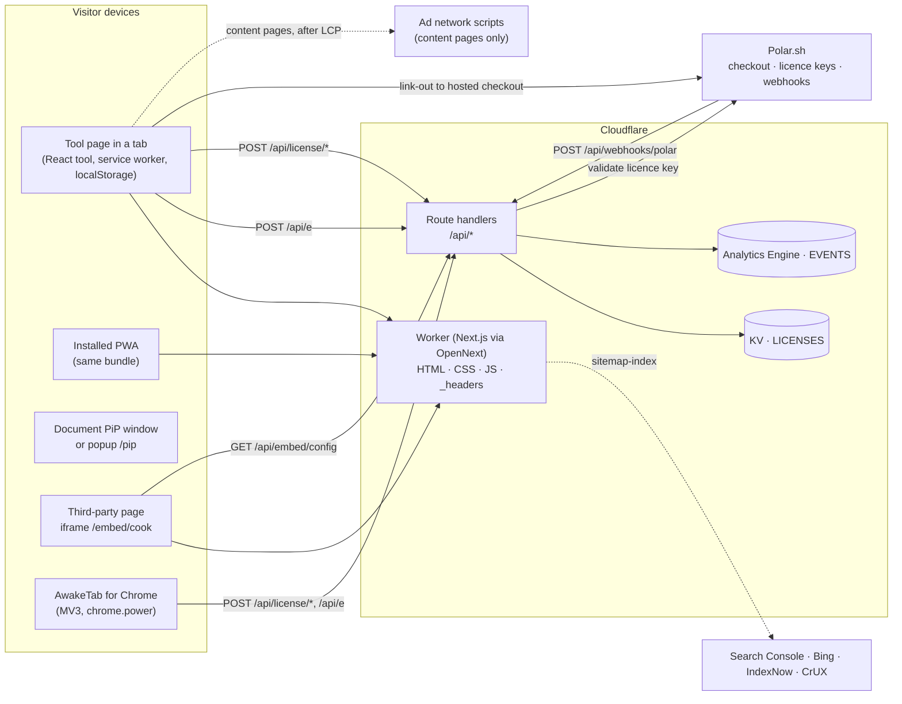
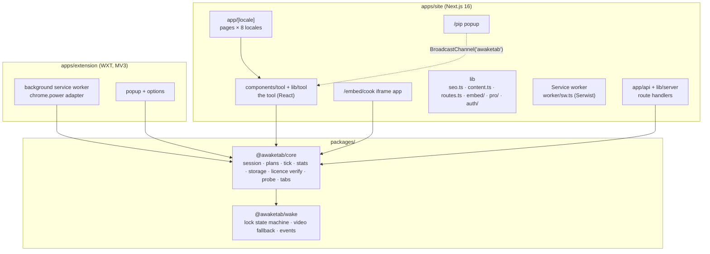
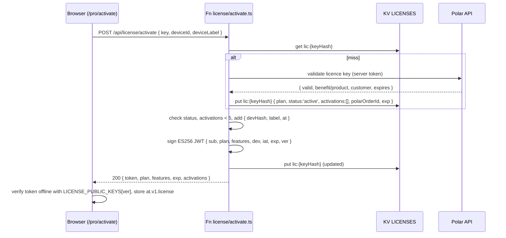

# 03 · Architecture

Status: v2.0 · 2026-11-13 · Owner: Soubhik

**Purpose.** This document describes how AwakeTab is put together: the systems it talks to, the packages in the monorepo and what each owns, how the tool runs in the browser, how the site is built, the request flows for licences and analytics, the environments and their secrets, the security and performance models, and the architecture decisions that explain why it looks this way. Identifiers follow `00-conventions.md` exactly.

**Related docs.** `00-conventions.md` (canonical names; wins on conflict) · `04-engine-spec.md` (lock and session state machines) · `08-data-storage.md` (storage keys, KV, Analytics Engine schema) · `12-library-spec.md` (`@awaketab/wake` as a public package) · `13-testing-strategy.md` · `14-devops.md` · `DEPLOYMENT.md`.

---

## 1. System context

AwakeTab is a website with a small serverless edge. Nothing in the free product requires an account or a cookie; sign-in exists only for Pro, which ships switched off. The browser does the real work (holding the Screen Wake Lock); the edge exists for three narrow jobs: accept anonymous analytics beacons from visitors who allowed counting, issue and re-validate Pro licence tokens, and answer embed-config lookups.

| Actor / system | Role | Talks to us via |
|---|---|---|
| Visitor's browser tab | Runs the tool; holds the wake lock; stores state in `localStorage` | HTML/JS from the Cloudflare Worker; `POST /api/e` |
| Installed PWA | Same code as the tab, launched standalone; the service worker (`apps/site/worker/sw.ts`) precaches the offline pages | Same as above |
| Document Picture-in-Picture window | Chromium-only floating pill; a same-origin document opened by the tool (`/pip` is the popup fallback) | In-process |
| Embed iframe (`/embed/cook`) | Cook Mode widget on third-party recipe sites; needs `allow="screen-wake-lock"` on the host `<iframe>` | `GET /api/embed/config?domain=` |
| AwakeTab for Chrome (MV3) | Keeps the display awake with `chrome.power` even when the tab is hidden; shares `@awaketab/core` | `POST /api/license/*` (Pro), `POST /api/e` |
| Cloudflare Workers (`awaketab-site`, preview `awaketab-site-preview`) | The Next.js site through OpenNext: pages, static assets, `_headers`, and the `/api/*` route handlers (`00-conventions.md` §9) | — |
| Cloudflare D1 (binding `AUTH_DB`) | Sign-in accounts and sessions (Better Auth) | From the route handlers only |
| Cloudflare KV (binding `LICENSES`) | Licence records, embed configs, webhook idempotency keys, feedback and ratings | From the route handlers only |
| Workers Rate Limiting (bindings `RL_EVENTS`, `RL_FEEDBACK`, `RL_LICENSE`) | Request limits per caller for the public `POST` routes | From the route handlers only |
| Workers Analytics Engine (dataset `EVENTS`) | Append-only event store, 90-day retention, SQL API | From `/api/e` only |
| Polar.sh | Merchant of record: hosted checkout, licence-key issuance, customer portal, webhooks | `POST /api/webhooks/polar`; server-to-server licence-key validation |
| Ad networks (AdSense → Journey → Raptive/Mediavine) | Display ads on content pages only, after gate G1 | Loader module in the content layout |
| Google Search Console, Bing, IndexNow, CrUX | Indexing submission, field performance data | Sitemap, ping, dashboards |
| Chrome Web Store, Edge Add-ons, npm, GitHub | Distribution of the extension and `@awaketab/wake` | The extension package is built by hand (`apps/extension/store/PUBLISHING.md`); the library is published by `release.yml` |
| Buy Me a Coffee | Donations (gate G0) | Link-out only; no scripts |



---

## 2. Component view



The dependency direction is strict: `wake` depends on nothing; `core` depends on `wake` (types and the emitter); the apps depend on both; the route handlers import only the pure parts of `core` (token claims types, key hashing) and never anything that touches `window`.

---

## 3. Monorepo layout and responsibilities

The tree is fixed in `00-conventions.md` §4. Responsibilities per package:

| Path | Owns | Must not |
|---|---|---|
| `packages/wake` (`@awaketab/wake`) | The seven lock states, `navigator.wakeLock` handling, the `release` and `visibilitychange` wiring, retry and backoff, the video fallback, `change` and `error` events, `createEmitter`. The only package published to npm, and the only part under the MIT licence. | Know about sessions, storage or the UI; take a dependency. |
| `packages/core` (`@awaketab/core`) | Session and plan types, the wall-clock tick, pause and resume, the end-of-session pipeline, the battery monitor, stats, the `at.v1.*` storage schema and `migrate()`, licence token verification (ES256), the capability probe, the multi-tab protocol. Private to the repository, AGPL-3.0-only like the two apps. | Import a UI framework; touch the DOM beyond the browser APIs it wraps. |
| `apps/site/app` | Routes (`00-conventions.md` §7): the pages under `[locale]`, the API route handlers under `api`, `og`, `robots`, `sitemap`, `manifest`, `rss.xml`, `embed.js`. | Hold logic that belongs in `lib` or a component. |
| `apps/site/components` | The tool (`tool/`), the clock faces (`face/`), the site shell and page blocks (`site/`), the embed widget, the floating window, Pro and sign-in panels, and `ui/`, the shadcn/ui primitives. | Add raw colours or sizes: tokens come from `app/globals.css`. |
| `apps/site/lib` | `server/` (API helpers, licences, Polar, rate limit, response headers), `auth/` (Better Auth), `embed/`, `tool/`, `pro/`, `seo.ts`, `content.ts`, `routes.ts`. | Set cookies outside sign-in; log IP addresses; hold state outside KV, D1 and Analytics Engine. |
| `apps/site/content`, `messages`, `i18n` | The Markdown collections `for/`, `on/`, `vs/`, `guides/`, `learn/` per locale, the UI strings and the locale routing. | — |
| `apps/site/worker/sw.ts` | The service worker source, bundled to `public/serwist/sw.js` before `next build`. | — |
| `apps/extension` | The WXT project: popup, options and the background service worker, which holds the lock through `chrome.power.requestKeepAwake('display')`. | Load remote code; show ads. |
| `scripts/` | Setup, licence keys, KV backups, the IndexNow ping and the lint helpers. | — |
| `docs/` | This set. | — |

---

## 4. Runtime architecture of the tool

The tool is a React component tree (`apps/site/components/tool`, state and helpers in `apps/site/lib/tool`). The home page is the tool; content pages show a tool card that starts a session on the home page with the documented query parameters.

- **Engine.** The components never talk to `navigator.wakeLock`. They drive the session engine in `@awaketab/core`, which drives the lock in `@awaketab/wake`. The status pill shows the lock state the engine reports, never the user's intent (`04-engine-spec.md`).
- **Storage.** Settings, the session and stats are read and written through the `at.v1.*` keys (`08-data-storage.md`). A reload restores the running session from `at.v1.session` and asks for the lock again by itself; where the browser wants a tap first, the session waits as "needs you" with its clock still running.
- **Paused and needs you.** A session is paused only when the person presses Pause. A hidden tab that lost the lock is "needs you": the clock runs on to the same end time, and the lock is asked for again when the tab is visible (`00-conventions.md` §5.1).
- **Feature packs.** Clock faces, sounds, notes and the focus tools load when they are first used.
- **Offline.** The service worker precaches the offline pages and the widget templates; a new revision ships with every build.

### 4.1 Event bus

`@awaketab/wake` exports a small typed emitter used everywhere:

```ts
export interface IEmitter<E extends Record<string, unknown>> {
  on<K extends keyof E>(type: K, fn: (ev: E[K]) => void): () => void;
  emit<K extends keyof E>(type: K, ev: E[K]): void;
  clear(): void;
}
export function createEmitter<E extends Record<string, unknown>>(): IEmitter<E>;
```

### 4.2 Multi-tab coordination

`BroadcastChannel('awaketab')` carries `{ type: 'hello' | 'lock' | 'state' | 'intent' | 'bye', tabId, ts, ... }` (protocol in `04-engine-spec.md` §14). It serves the "another tab is keeping this screen awake" banner with Take over, and the `/pip` popup, which mirrors the engine's state snapshots and sends intents back. A tab that holds the lock repeats its state every 3 s as a heartbeat; a tab not heard from for 10 s is forgotten, so a crashed or discarded tab stops counting as the holder.

### 4.3 Floating window

Where the browser has Document Picture-in-Picture, the tool opens a small same-origin window with the pill, the time left and the session controls. Elsewhere `/pip` opens as a popup and mirrors the session over the channel above. The window holds a screen wake lock of its own while it is open (`apps/site/lib/surfaces/own-lock.ts`), so the screen stays awake while the tab that opened it sits behind other windows; it has no session of its own.

---

## 5. Build pipeline

1. `content-collections build` turns the Markdown under `apps/site/content` into typed collections (`apps/site/content-collections.ts`). It runs on install and as part of the build, and it rejects bad frontmatter.
2. `node scripts/build-sw.mjs` bundles `worker/sw.ts` with esbuild to `public/serwist/sw.js`.
3. `next build` builds the site. `NEXT_PUBLIC_*` settings are read here.
4. `opennextjs-cloudflare build` turns the Next.js output into the Worker (`.open-next/`), and `opennextjs-cloudflare deploy` uploads it with the bindings in `wrangler.jsonc`.

Every page is prerendered and changes only with a deploy. `apps/site/open-next.config.ts` uses OpenNext's static-assets incremental cache with cache interception, so the build's copy of a page is served from the Worker's static assets (binding `ASSETS`) and a prerendered page is answered before the Next server is loaded. `next.config.ts` writes the commit being built into the bundle as `COMMIT_SHA` (from `WORKERS_CI_COMMIT_SHA`, which Workers Builds sets, then `COMMIT_SHA`, then `git rev-parse HEAD`), and `/api/health` reports its first 12 characters as `version`.

`pnpm build` at the root runs steps 1 to 3 for the site after building the two packages, and builds the extension with WXT. In production and on the preview, Cloudflare Workers Builds runs all four steps on every push to `main` and to `play`; `DEPLOYMENT.md` has the exact commands.

---

## 6. Request and response flows

### 6.1 Licence activation



Error responses are `{ error: 'invalid_key' | 'revoked' | 'activation_limit' | 'rate_limited' | 'upstream' }` with 400/403/429/502. Deactivation (`POST /api/license/deactivate { token, deviceId }`) verifies the token server-side, removes the matching `devHash` and returns the new list. Validation (`POST /api/license/validate { token }`) re-reads `lic:{keyHash}` and either re-signs a fresh token or returns `{ revoked: true }`.

### 6.2 Polar webhook

`POST /api/webhooks/polar` → verify signature (§8) → check `wh:{eventId}` (skip if present) → apply: `order.created` / `benefit_grant.created` create or refresh `lic:{keyHash}`; `subscription.active|updated` refresh `exp`; `subscription.revoked|canceled` (at period end) and `benefit_grant.revoked` set `status: 'revoked'`; refunds set `status: 'refunded'`. For `biz_embed_site_yearly` orders with a `domain` custom field, also write `embed:{domain}`. Always respond 200 within 5 s; unknown event types are acknowledged and ignored.

### 6.3 Analytics beacon

```mermaid
sequenceDiagram
  participant T as Tab (lib/telemetry)
  participant F as Route handler /api/e
  participant L as Rate limit binding (RL_EVENTS)
  participant AE as Analytics Engine
  T->>T: track(event, fields) → queue, only while telemetry is true
  T->>F: POST /api/e (sendBeacon when the tab is hidden or closed, at 20 events, or 15 s after the first waiting event; fetch keepalive as the fallback)
  F->>L: limit({ key: route + salted address hash })
  alt over limit
    F-->>T: 429 rate_limited
  else
    F->>F: read the body up to 8 KB (413 beyond it), ≤ 20 events, known event names, known fields only
    F->>F: add country, device class, browser family and the daily visitor key (site events only)
    F->>AE: writeDataPoint × n
    F-->>T: 200 { ok, n }
  end
```

Analytics is opt-in. The sender starts only after the person presses Allow on the "Count this visit?" card or turns on "Count my visits" in Settings (`telemetry: true` in `at.v1.settings`), and stops the moment that changes. Nothing is queued or sent for Global Privacy Control or Do Not Track, on the preview site, in a development build, or inside another site's frame. The client never retries. Events, columns and the report are in `ANALYTICS.md`.

### 6.4 Embed config

`/embed/cook` reads its embedding host from `document.referrer` (origin only) and calls `GET /api/embed/config?domain=<host>`. The route handler normalises the domain (lowercase, punycode, strip `www.`), reads `embed:{domain}` (also accepting a registered staging subdomain), and returns `{ licensed, attribution, theme, expiresAt }` with `Cache-Control: public, max-age=300` and `Access-Control-Allow-Origin: *`. Unknown domains get `{ licensed: false, attribution: true, theme: 'auto', expiresAt: null }`.

---

## 7. Environments, configuration and secrets

| Environment | URL | How | Data |
|---|---|---|---|
| Local | `http://localhost:3000` | `pnpm dev` (`next dev`; `initOpenNextCloudflareForDev()` in `next.config.ts` gives it the Worker bindings from `wrangler.jsonc`); `apps/site/.dev.vars` holds local secrets; `pnpm -F site preview` runs the built Worker locally; Polar **sandbox** | Local wrangler bindings |
| Preview | `https://play.awaketab.com` (internal testing only, kept out of search) | Worker `awaketab-site-preview` (`env.preview` in `wrangler.jsonc`); Cloudflare Workers Builds deploys every push to the `play` branch (`DEPLOYMENT.md`) | Preview KV namespace, AE dataset `awaketab_events_preview`, D1 `awaketab-auth-preview`, its own rate limiters; Polar sandbox |
| Production | `https://awaketab.com` | Worker `awaketab-site`; Cloudflare Workers Builds deploys every push to `main` (`DEPLOYMENT.md`) | Production KV, AE `awaketab_events`, D1 `awaketab-auth`, its own rate limiters |

There are two long-lived branches. A feature branch is cut from `main`, merged into `play` and tested on play.awaketab.com, and then the same feature branch is merged into `main`. `play` is never merged into `main`. GitHub Actions run the checks on pushes to both branches and on pull requests; no GitHub workflow deploys (`14-devops.md` §1–§2).

`isSecureContext` is true on `localhost`, so the wake lock works in local development without HTTPS; the fallback video path is tested by launching Chromium with `--disable-features=WakeLock` or by injecting a fake (`04-engine-spec.md` §17).

Configuration (canonical list in `00-conventions.md` §13.3):

| Name | Kind | Where | Purpose |
|---|---|---|---|
| `POLAR_ACCESS_TOKEN` | secret | Worker (production; preview = sandbox token) | Server-to-server licence-key validation |
| `POLAR_WEBHOOK_SECRET` | secret | Worker | HMAC verification of `POST /api/webhooks/polar` |
| `LICENSE_SIGNING_KEY` | secret (private JWK, ES256 / P-256) + `LICENSE_SIGNING_VER` (integer `ver` claim) | Worker | Signs licence JWTs |
| `LICENSE_KEY_ENC_KEY` | secret (32-byte base64) | Worker | AES-GCM encrypts the raw Polar key at rest in KV |
| `POLAR_ORGANIZATION_ID`, `POLAR_BENEFIT_MAP` | secret / config | Worker | Organisation scope and benefit-id → plan map |
| `RATE_LIMIT_SALT` | secret (32 random bytes, rotated quarterly) | Worker | Salts the address hash used as the rate-limit key, and the daily visitor key of the analytics |
| `BETTER_AUTH_SECRET`, `GOOGLE_CLIENT_*`, `GITHUB_CLIENT_*` | secrets | Worker | Sign-in (Better Auth with Google, GitHub and passkeys) |
| `LICENSES` | KV namespace binding | `apps/site/wrangler.jsonc` | Licence, embed, webhook, feedback and rating records |
| `RL_EVENTS`, `RL_FEEDBACK`, `RL_LICENSE` | Workers Rate Limiting bindings (`ratelimits`) | `apps/site/wrangler.jsonc` | 30, 5 and 10 requests in 60 s per caller (§8) |
| `ASSETS` | static assets binding | `apps/site/wrangler.jsonc` | Hashed files and the prerendered pages |
| `EVENTS` | Analytics Engine dataset binding | `apps/site/wrangler.jsonc` | Analytics events |
| `AUTH_DB` | D1 database binding | `apps/site/wrangler.jsonc` (migrations in `apps/site/migrations`) | Sign-in accounts and sessions |
| `PUBLIC_SITE_URL` | Worker var | `wrangler.jsonc` `vars` | Sign-in and checkout return URLs |
| `PUBLIC_POLAR_SERVER` | Worker var (`production`/`sandbox`) | `wrangler.jsonc` `vars` | Polar API host for the route handlers |
| `LICENSE_PUBLIC_KEYS` | code constant in `@awaketab/core` (`Record<ver, JsonWebKey>`) | site + extension | Offline token verification; ships current and previous key |
| `NEXT_PUBLIC_POLAR_SERVER` | build-time public var | browser bundle | The Polar customer portal link |
| `NEXT_PUBLIC_ADS_ENABLED` | build-time public var (`'0'`/`'1'`) | browser bundle | Renders the ad slots on content pages (gate G1) |
| `NEXT_PUBLIC_PRO_ENABLED` | build-time public var | browser bundle | Turns Pro (sync, sign-in, checkout) on |
| `NEXT_PUBLIC_DEPLOY_ENV` | build-time public var (`play` on preview) | browser bundle and metadata | Keeps the preview out of search and out of the analytics |
| `COMMIT_SHA` | build-time value (from `WORKERS_CI_COMMIT_SHA` on Workers Builds) | server bundle | The commit `/api/health` reports |

Every setting is listed with its purpose in `apps/site/.env.example`. Rules: secrets never reach the client bundle (only `NEXT_PUBLIC_*` do; Next.js enforces this); the private key exists only in Cloudflare secrets and a password manager; key rotation bumps `LICENSE_SIGNING_VER` (the `ver` claim) and ships both public keys in `LICENSE_PUBLIC_KEYS` for 90 days.

---

## 8. Security model

**Response headers** come from `apps/site/lib/server/security-headers.ts` through `next.config.ts`:

| Routes | Headers |
|---|---|
| Every page except `/embed/*` | `Strict-Transport-Security`, `X-Content-Type-Options: nosniff`, `Referrer-Policy: strict-origin-when-cross-origin`, `Cross-Origin-Opener-Policy: same-origin-allow-popups`, a `Permissions-Policy` that allows only `screen-wake-lock`, `picture-in-picture` and `microphone` for the site itself, `X-Frame-Options: DENY`, and a CSP with `default-src 'self'`, `frame-ancestors 'none'`, no third-party script host and `form-action` limited to the site and Polar |
| Content pages (`/for/*`, `/on/*`, `/vs/*`, `/guides/*`, `/learn/*` and their locale copies) | The same, with a CSP that also allows the ad network's documented hosts |
| `/embed/*` | The common headers, `frame-ancestors *` and `X-Robots-Tag: noindex` |
| `/api/*` | `X-Robots-Tag: noindex` |
| Everything on the preview build | `X-Robots-Tag: noindex, nofollow` |

`script-src` allows inline scripts because the App Router writes its own inline boot scripts without a nonce. `media-src data:` is needed for the base64 fallback video. CSP violations are reported to `/api/csp`. Polar checkout is never embedded: the site links out to the hosted checkout.

**Cookies.** The free tool sets none, and Cloudflare features that inject cookies (Bot Fight Mode's challenge cookie, Zaraz, Web Analytics) stay off. Sign-in, which ships switched off with Pro, uses Better Auth's session cookie.

**Rate limiting.** Cloudflare's Workers Rate Limiting bindings, declared under `ratelimits` in `apps/site/wrangler.jsonc` for each Worker: `RL_EVENTS` (30 requests in 60 s: `/api/e`, `/api/csp`), `RL_FEEDBACK` (5 in 60 s: `/api/feedback`, `/api/rating`) and `RL_LICENSE` (10 in 60 s: `/api/license/*`, `/api/checkout`, passkey registration). Each request is counted under the key `{route}:{ipHash}`, where `ipHash` is a salted SHA-256 of the address (`RATE_LIMIT_SALT`); the raw address is never written anywhere, and nothing is written to KV. Without the binding (a local server, tests) `apps/site/lib/server/ratelimit.ts` counts in memory per isolate in the same one-minute window. The limiter fails open: if it throws, the request goes through, so it can never take a route down. Cloudflare's counters are kept per location and are approximate by design.

**Webhook verification.** Polar's SDK verifies each webhook's signature and timestamp. The handler then checks `wh:{eventId}` in KV: present means a replay, which is answered 200 and ignored; otherwise the event is applied and `wh:{eventId}` is written for 30 days.

**Licence tokens.** ES256 JWT, verified offline in the browser and the extension with the embedded public key; the private key never leaves Cloudflare. Tokens are bound to `dev` (the device's random UUID), so a copied token is useless on another device. Details in `08-data-storage.md` §2.4.

**Embed.** The widget runs in our origin's iframe, so the host page cannot remove the attribution; `frame-ancestors *` is deliberate. Host pages must add `allow="screen-wake-lock"` or the lock request fails with `NotAllowedError` and the engine reports `denied` with advice `iframe_no_allow` (`04-engine-spec.md` §3).

**Extension.** MV3, no remote code. Permissions are `power`, `alarms`, `storage`, `offscreen` and `activeTab`; site access is optional and asked for one site at a time. CSP is the MV3 default.

---

## 9. Performance architecture

| Slice | Budget | Mechanism |
|---|---|---|
| `@awaketab/wake` | Core entry ≤ 3.4 KB gz; the fallback clips are a separate entry (`@awaketab/wake/video`, ≤ 2.2 KB) loaded on first use; IIFE ≤ 5.8 KB; each adapter ≤ 400 B (`size-limit`, `packages/wake/package.json`) | Hand-written state machine, no classes, no dependencies |
| `@awaketab/core` | ≤ 7 KB (`size-limit`, `packages/core/package.json`) | No schema library; hand-written guards |
| The site | No byte budget is set yet (`00-conventions.md` §11) | Prerendered pages are served from the Worker's static assets; faces other than Ring load on first use; fonts are self-hosted by `next/font`, and Japanese and Chinese use the device's fonts, so pages make no third-party font request |
| Lighthouse (mobile) | Performance ≥ 95, LCP ≤ 1.2 s, TBT ≤ 100 ms, CLS 0 | Lighthouse CI on every pull request (`13-testing-strategy.md` §6) |

Tool routes make no third-party request. Ad slots exist only on content pages, have fixed dimensions and are drawn only when `NEXT_PUBLIC_ADS_ENABLED` is `1`.

---

## 10. Architecture decision records

Format: Context · Decision · Alternatives · Consequences. Numbers are stable; a decision that was replaced is removed, so the list has gaps.

### ADR-004 · KV + Analytics Engine for licences and events

**Context.** Server state is limited to licence records (thousands, rarely written), embed configs (hundreds), idempotency keys and counters; analytics is append-only and aggregate-only. **Decision.** KV for records with TTLs; Analytics Engine for events with 90-day retention and SQL. **Alternatives.** D1/SQLite (adds migrations and a relational model we do not need); Postgres (Neon/Supabase — overkill, another bill, another secret); Cloudflare Web Analytics for events (no custom events). **Consequences.** Zero operational database work; eventual consistency accepted for licences (activation limits are advisory ±1). Rate limits do not use KV: they are Workers Rate Limiting bindings (§8). No per-user analytics is possible — which is the privacy promise anyway.

### ADR-005 · Polar.sh as merchant of record over Stripe / Lemon Squeezy

**Context.** The seller is an individual in India. Stripe India does not allow individuals to accept international payments; Lemon Squeezy's successor (Stripe Managed Payments) did not list India at decision time. Need licence keys, webhooks, global tax handling. **Decision.** Polar.sh (5% + 50¢; licence-key benefit; Standard Webhooks; payouts via Stripe Connect Express). **Alternatives.** Dodo Payments (4% + 40¢, UPI — kept as a v2 alternative for INR pricing); Paddle (minimum volumes, slower onboarding); Gumroad (weak licence API, higher fee). **Consequences.** Polar handles VAT/GST as MoR; we hold no card data; checkout is a link-out so no third-party script on `/pro`. Pricing changes are a Polar dashboard task; our code only maps Polar product IDs to `pro_yearly`, `pro_monthly`, `biz_embed_site_yearly`, `biz_kiosk_site`, `biz_kiosk_5`.

### ADR-006 · Own video fallback over NoSleep.js

**Context.** NoSleep.js has not shipped since December 2020, has ~49 open issues, reaches into private fields, and its video weighs tens of KB; competitors' UIs claim "awake" when the promise rejected. **Decision.** Implement the fallback ourselves inside `@awaketab/wake`: a `playsinline` video rendered at 1 × 1 px, not muted and not looping, playing a 10-second black clip that has a video track and a silent audio track (WebM and MP4, ≤ 2.2 KB gz together, in their own entry loaded on first use). The state is reported as `fallback` only once playback is seen to advance; a 20 s watchdog checks it keeps advancing; it pauses when hidden. Browsers keep the display on only for a video they treat as real media, which is why the clip has sound and is not muted (`04-engine-spec.md` §1, §5). **Alternatives.** NoSleep.js (abandoned, heavy); no fallback at all (drops Safari < 16.4, Firefox < 126); audio-based tricks (blocked by autoplay policy, worse for battery). **Consequences.** We own a small amount of platform-quirk code and the test matrix for it; the state pill can never lie because the state comes from the promise and the sentinel. The same code becomes the open-source library's selling point (ADR-010, `12-library-spec.md`).

### ADR-007 · First-party beacon over Cloudflare Web Analytics / Plausible

**Context.** We need product events (`session_start`, `lock_denied`, `fallback_used`, Pro funnel), zero third-party requests on tool pages, and no cookies. **Decision.** `POST /api/e` batched beacon into Analytics Engine; no third-party script. Since November 2026 it is opt-in: nothing is sent until the person allows it (§6.3, `ANALYTICS.md`). **Alternatives.** Cloudflare Web Analytics (free, cookieless, but a third-party script and no custom events); Plausible/Umami (custom events, but a script and a monthly bill or a server to run); GA4 (cookies/consent burden, blocked widely). **Consequences.** ~1 KB of client code; we write our own report (`scripts/metrics.mjs`); every number is among visitors who allowed counting; unique visitors are counted with a daily key that cannot be followed into the next day, and there is no returning-visitor metric.

### ADR-008 · ES256 JWT licence tokens verified offline over server-checked sessions

**Context.** Pro must work offline (installed PWA on a flight, extension on a locked-down laptop); no accounts; 5-device limit. **Decision.** The route handler signs a compact JWT (`{ sub, plan, features, dev, iat, exp, ver }`) with an ES256 private key; clients verify with the embedded public key via WebCrypto; re-validate on a cadence (`08-data-storage.md` §2.4). **Alternatives.** Check the key against the server on every load (fails offline, adds latency, leaks usage patterns); HS256 (would put the secret in the client); Ed25519 (WebCrypto support arrived late in Safari; P-256 is universal). **Consequences.** Offline-first Pro with revocation latency bounded by the re-validation window (24 h yearly, 90 days lifetime) — acceptable for a $12 product. A determined user can patch the client; we do not fight that.

### ADR-009 · WXT for the extension

**Context.** MV3 Chromium extension with popup, options and a background service worker; want to share `@awaketab/core` and TypeScript config; publish to Chrome Web Store and Edge Add-ons. **Decision.** WXT (Vite-based, file-system entrypoints, typed manifest, auto-reload, multi-browser builds). **Alternatives.** Plasmo (React-centric, less active); CRXJS Vite plugin (lower level, maintenance lulls); hand-rolled Vite config (works, but reinvents manifest handling and HMR). **Consequences.** Fast iteration and a `wxt zip` release artefact; Firefox build is one flag away for later, though Firefox lacks `browser.power` so v1 targets Chromium only.

### ADR-010 · Monorepo with `@awaketab/core` shared by web + extension

**Context.** The session engine, plans, stats, storage schema and licence verification must behave identically in the tab, the PiP window, the embed iframe and the extension. **Decision.** pnpm workspaces; `packages/wake` (public) and `packages/core` (internal) consumed as workspace dependencies by `apps/site` and `apps/extension`. **Alternatives.** Copy-paste into each app (drift within weeks); separate repos with published packages (release overhead for one person); a single app with the extension as a build target (couples the site's and WXT's build configs). **Consequences.** One test suite for the engine; the extension's `chrome.power` adapter implements the `WakeLock` interface so `core` does not know which platform it runs on. Cost: workspace tooling (turbo optional) and careful `exports` maps.

### ADR-011 · Locale subfolders over subdomains

**Context.** 8 launch locales; SEO authority should accrue to one host, served by one Worker. **Decision.** `/{lang}/…` subfolders with English at root, reciprocal hreflang, `x-default` → root; `next-intl` routing (`apps/site/i18n`). **Alternatives.** Subdomains (`es.awaketab.com` — splits authority, needs per-host config, complicates the PWA scope and `localStorage`); ccTLDs (cost, admin, no benefit for a tool); query parameter (not indexable as distinct pages). **Consequences.** One PWA scope, one `localStorage`, one `_headers`; translated slugs allowed per locale via the content collection's `slug` field with hreflang linking.

### ADR-015 · Next.js 16 on Cloudflare Workers

Status: **Accepted, 2026-10-30** (owner).

**Context.** The design specifies Next.js 16 (App Router), Tailwind CSS 4, shadcn/ui, TypeScript, `next-themes` and `lucide-react`, and sign-in and Pro need a server and a database. **Decision.** Build the site in `apps/site` on exactly that stack and run it on Cloudflare Workers through OpenNext, with the API as Next.js route handlers, KV for licences, Analytics Engine for events and D1 for sign-in. **Consequences.** The tool renders with React; production and preview are separate Workers with separate bindings (`DEPLOYMENT.md`); byte budgets for the site still have to be set (`00-conventions.md` §11).
